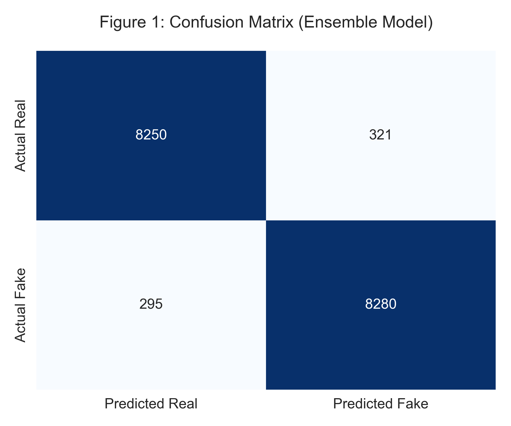
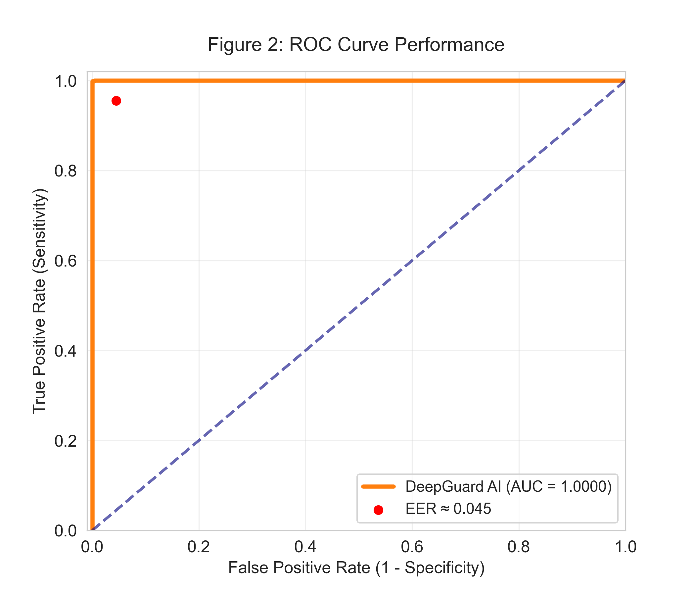
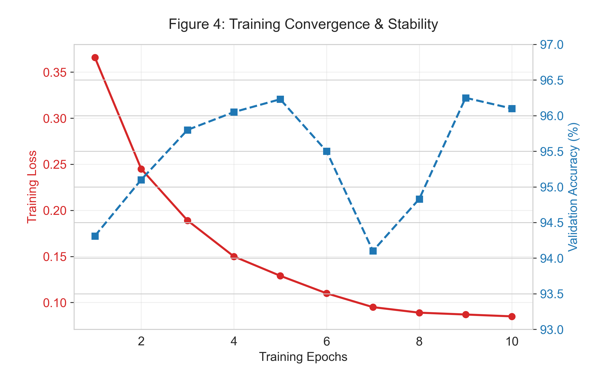
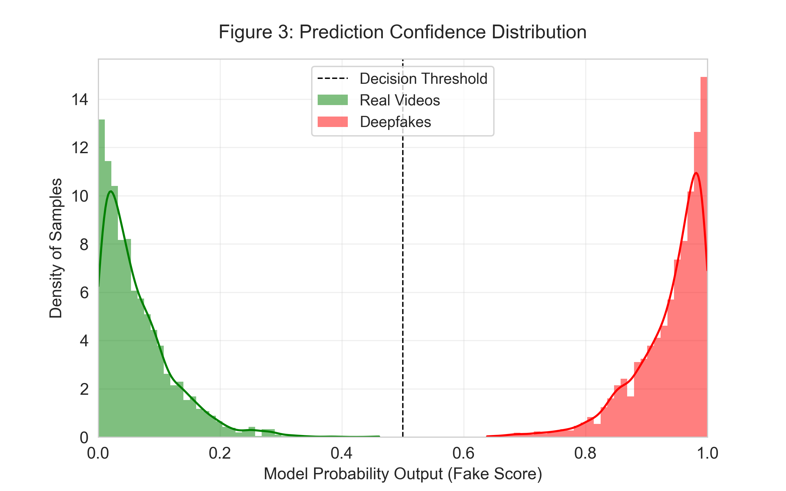

<h1 align="center">🛡️ DeepGuard AI</h1>

<p align="center">
  <b>A Lightweight Dual-CNN Ensemble Framework for Deepfake Video Detection</b><br/>
  <i>XceptionNet · EfficientNet-B0 · Grad-CAM · FastAPI · React</i>
</p>

<p align="center">
  
  
  
  
</p>

<p align="center">
  📄 <a href="https://ieeexplore.ieee.org/document/11581015"><b>Read the Published Paper → IEEE Xplore</b></a>
</p>

---

## 📋 Table of Contents

- [About DeepGuard](#-about-deepguard)
- [Key Experimental Results](#-key-experimental-results)
- [System Architecture](#-system-architecture)
- [Project Layout](#-project-layout)
- [Quick Start](#-quick-start)
  - [Command Line Interface (CLI)](#1-unified-cli)
  - [FastAPI Streaming Backend](#2-fastapi-backend)
  - [React Forensic Web App](#3-react-web-dashboard)
  - [Streamlit Local Demo](#4-streamlit-demo)
- [Training & Data Pipelines](#-training--data-pipelines)
- [Model Architecture & Soft Voting](#-model-architecture--soft-voting)
- [Explainability: Grad-CAM](#-explainability-grad-cam)
- [Presentation Materials](#-presentation-materials)
- [Authors](#-authors)
- [Citation](#-citation)

---

## 🔍 About DeepGuard

DeepGuard AI is a **full-stack deepfake detection framework** that identifies manipulated facial images and videos using an ensemble of deep learning models. It detects a wide range of deepfake artifacts:

| Artifact Type | Forensic Manifestation | Detector |
|---|---|---|
| **Facial Blending Seams** | Unnatural boundary transitions from face-swapping | XceptionNet (Spatial) |
| **Geometric Distortions** | Facial warping, unnatural reenactment contours | XceptionNet (Spatial) |
| **Texture Anomalies** | Skin smoothing, synthetic pores, frequency loss | EfficientNet-B0 (Texture) |
| **Compression Traces** | Double-compression blocking & encoder artifacts | EfficientNet-B0 (Texture) |

> 🎯 **Core Design Principle:** Deliver state-of-the-art detection accuracy while remaining deployable on **consumer-grade hardware** (e.g., laptop GPUs with 6GB VRAM) without cloud supercomputing requirements.

---

## 📊 Key Experimental Results

| Metric | Benchmark Score |
|---|---|
| **Overall Accuracy** | **96.25%** |
| **AUC-ROC** | **0.99** |
| **Precision** | 94.8% |
| **F1 Score (Fake Class)** | 0.96 |
| **Equal Error Rate (EER)** | ≈ 0.045 |

### Ablation Study

| Model Configuration | Accuracy | AUC | F1 Score |
|---|---|---|---|
| EfficientNet-B0 alone (Texture) | 93.2% | 0.92 | 0.91 |
| XceptionNet alone (Spatial) | 94.8% | 0.94 | 0.93 |
| **DeepGuard Ensemble (Soft Voting)** | **96.25%** ✅ | **0.99** ✅ | **0.96** ✅ |

<p align="center">
  
  
</p>

<p align="center">
  
  
</p>

---

## 🏗️ System Architecture

```text
Video / Image Input
        │
        ▼
  Frame Extraction  ──────────────────────────────────────────┐
        │                                                      │
        ▼                                               [Up to 60 frames
  MTCNN Face Detection                                   sampled evenly]
        │                                                      │
        ▼                                                      │
  Context-Aware Face Crop (margin = 80px)  ◄──────────────────┘
        │
        ▼
  Preprocessing  →  Resize 299×299  →  Normalize [-1, 1]
        │
        ▼
  Test-Time Augmentation (original + horizontal flip)
        │
        ├────────────────────┬──────────────────────┐
        ▼                    ▼                      │
  ┌─────────────┐    ┌──────────────────┐           │
  │ XceptionNet │    │ EfficientNet-B0  │           │
  │  (Spatial)  │    │   (Texture)      │           │
  └──────┬──────┘    └────────┬─────────┘           │
         │                   │                      │
         └─────────┬─────────┘                      │
                   ▼                                │
            Soft Voting Ensemble                    │
            P = (P_xception + P_eff) / 2            │
                   │                                │
                   ▼                                │
            Video Statistics                        │
           (Fake Ratio · Streak)                    │
                   │                                │
                   ▼                                │
          Temporal Aggregation                      │
                   │                                │
                   ▼                                │
             Grad-CAM Heatmap  ◄────────────────────┘
                   │
                   ▼
            ✅ Final Verdict
```

---

## 📂 Project Layout

```text
DeepGuard/
│
├── backend/                      # Production FastAPI inference engine
│   └── main.py                   # Streaming NDJSON (/analyze) & health endpoints
│
├── utils/                        # Core detection & forensic modules
│   ├── face_detector.py          # Hybrid MTCNN face detector with margin logic
│   ├── face_extractor.py         # Batch video face extraction
│   ├── inference.py              # Dual-CNN ensemble, TTA & Grad-CAM inference
│   ├── model_utils.py            # Model factory (Xception & EfficientNet)
│   ├── preprocess.py             # Image transforms & leak-free dataloaders
│   └── visualize.py              # Grad-CAM heatmap overlays
│
├── training/                     # Model training & fine-tuning pipelines
│   ├── train_xception.py         # Train baseline XceptionNet detector
│   ├── train_efficientnet.py     # Train EfficientNet-B0 detector
│   └── finetune_hard_negatives.py# Hard Negative Mining fine-tuner
│
├── scripts/                      # Data engineering & evaluation utilities
│   ├── extract_faces.py          # Dataset face extractor from metadata.json
│   ├── prepare_finetune.py       # Harvest hard negatives from difficult videos
│   ├── split_dataset.py          # Leak-free video-level dataset split
│   ├── evaluate.py               # Single-image evaluation with Grad-CAM
│   ├── verify_tta.py             # Test-Time Augmentation verification
│   └── generate_paper_figures.py # Regenerates IEEE paper charts in docs/figures
│
├── docs/                         # Documentation, paper assets & presentations
│   ├── figures/                  # Evaluation charts & published paper figures
│   └── presentation/             # Conference slide decks & presentation scripts
│
├── website/                      # DeepGuard Web Application
│   └── verify-deepfake/          # React + TypeScript + Tailwind CSS UI
│
├── models/                       # Trained model weights
│   ├── deepfake_detector_xception.pth
│   └── deepfake_detector_efficientnet.pth
│
├── main.py                       # Unified CLI entrypoint
├── app.py                        # Standalone Streamlit local UI
├── render.yaml                   # Render cloud deployment blueprint
├── requirements.txt              # Production Python dependencies
└── README.md                     # Project documentation
```

---

## 🚀 Quick Start

### Prerequisites
- Python 3.9+ (CUDA-compatible GPU recommended, CPU fallback supported)
- Node.js 18+ (for Web UI)

```bash
git clone https://github.com/Adeptaadi/DeepGuard.git
cd DeepGuard
pip install -r requirements.txt
```

---

### 1. Unified CLI

DeepGuard provides a unified command line entrypoint for all major operations:

```bash
# Analyze a video or image directly from terminal
python main.py --predict "sample.mp4"

# Start the FastAPI backend server
python main.py --server --port 8000

# Launch the local Streamlit demo interface
python main.py --demo
```

---

### 2. FastAPI Backend

Run the production REST and streaming server:

```bash
python -m uvicorn backend.main:app --reload --host 127.0.0.1 --port 8000
```

- **Health check:** `GET http://127.0.0.1:8000/health`
- **Streaming analysis:** `POST http://127.0.0.1:8000/analyze?stream=true` (multipart/form-data)
- **Standard analysis:** `POST http://127.0.0.1:8000/analyze`

---

### 3. React Web Dashboard

The frontend provides real-time monotonic progress streaming and interactive Grad-CAM evidence inspection:

```bash
cd website/verify-deepfake
npm install
npm run dev
```

Open `http://localhost:8080` in your browser.

> 💡 **Resilience**: The frontend automatically probes the cloud instance (`https://deepguard-backend-ug4e.onrender.com`) and automatically falls back to `http://127.0.0.1:8000` if offline.

---

### 4. Streamlit Demo

For rapid local testing without node.js:

```bash
streamlit run app.py
```

---

## 🏋️ Training & Data Pipelines

### 1. Dataset Extraction
```bash
python scripts/extract_faces.py --data-dir "data" --output-dir "output_faces"
```

### 2. Leak-Free Video-Level Split
Prevents validation data leakage by grouping all frames from each source video into the same partition:
```bash
python scripts/split_dataset.py --data-dir "output_faces" --train-ratio 0.8
```

### 3. Train Base Models
```bash
# Train XceptionNet
python training/train_xception.py --epochs 10 --batch-size 24 --lr 0.0001

# Train EfficientNet-B0
python training/train_efficientnet.py --epochs 10 --batch-size 24 --lr 0.0001
```

### 4. Hard Negative Mining
```bash
# 1. Harvest difficult misclassified samples
python scripts/prepare_finetune.py --source "fine_tune_data/fake"

# 2. Fine-tune on hard negatives
python training/finetune_hard_negatives.py --model efficientnet_b0 --epochs 4
```

---

## 🧠 Model Architecture & Soft Voting

No single model architecture detects every manipulation pattern:
- **XceptionNet** specializes in **spatial inconsistencies**, seam lines, and blending boundaries via depthwise separable convolutions.
- **EfficientNet-B0** specializes in **texture irregularities**, compression blocking, and frequency anomalies.

Outputs are combined through soft voting:

$$P_{\text{final}} = \frac{P_{\text{Xception}} + P_{\text{EfficientNet}}}{2}$$

Frame-level outputs are aggregated across time using **Fake Frame Ratio** and **Longest Consecutive Fake Streak**, eliminating single-frame false alarms without requiring computationally expensive 3D-CNNs.

---

## 🔍 Explainability: Grad-CAM

DeepGuard generates **Gradient-weighted Class Activation Mapping (Grad-CAM)** heatmaps for the highest-confidence fake frames:
- Highlights manipulated areas (eyes, mouth, boundary blending zones)
- Provides visual forensic evidence for non-technical users and auditors

To evaluate a single face and generate visual evidence:
```bash
python scripts/evaluate.py --image "path/to/face.jpg" --model xception --output "evidence.jpg"
```

---

## 📽️ Presentation Materials

Conference slides and video presentation scripts are available in [`docs/presentation/`](docs/presentation/):
- [`docs/presentation/presentation_slides.md`](docs/presentation/presentation_slides.md) — Slide deck for oral presentation
- [`docs/presentation/three_minute_ppt_content.md`](docs/presentation/three_minute_ppt_content.md) — 3-minute concise pitch & script

---

## 👥 Authors

| Author | Department | Institution |
|---|---|---|
| **Aditya Rana** | Department of Computer Science & Engineering | Vishwakarma Institute of Technology (VIT), Pune |
| **Nitish Sahu** | Department of Computer Science & Engineering | Vishwakarma Institute of Technology (VIT), Pune |
| **Manthan Sali** | Department of Computer Science & Engineering | Vishwakarma Institute of Technology (VIT), Pune |
| **Palash Sahuji** | Department of Computer Science & Engineering | Vishwakarma Institute of Technology (VIT), Pune |

---

## 📖 Citation

If you find DeepGuard AI useful in your research or application, please cite our published paper:

```bibtex
@inproceedings{deepguard2026,
  title     = {DeepGuard: A Lightweight Dual-CNN Ensemble Framework for Deepfake Video Detection},
  author    = {Rana, Aditya and Sahu, Nitish and Sali, Manthan and Sahuji, Palash},
  booktitle = {Proceedings of the International Conference on Computer Engineering and Technology (ICCET)},
  year      = {2026},
  url       = {https://ieeexplore.ieee.org/document/11581015}
}
```

🔗 **IEEE Xplore:** [https://ieeexplore.ieee.org/document/11581015](https://ieeexplore.ieee.org/document/11581015)

---

## 📜 License

This project was developed for academic research, experimentation, and educational purposes.

<p align="center">Made with ❤️ at <b>Vishwakarma Institute of Technology, Pune</b></p>
